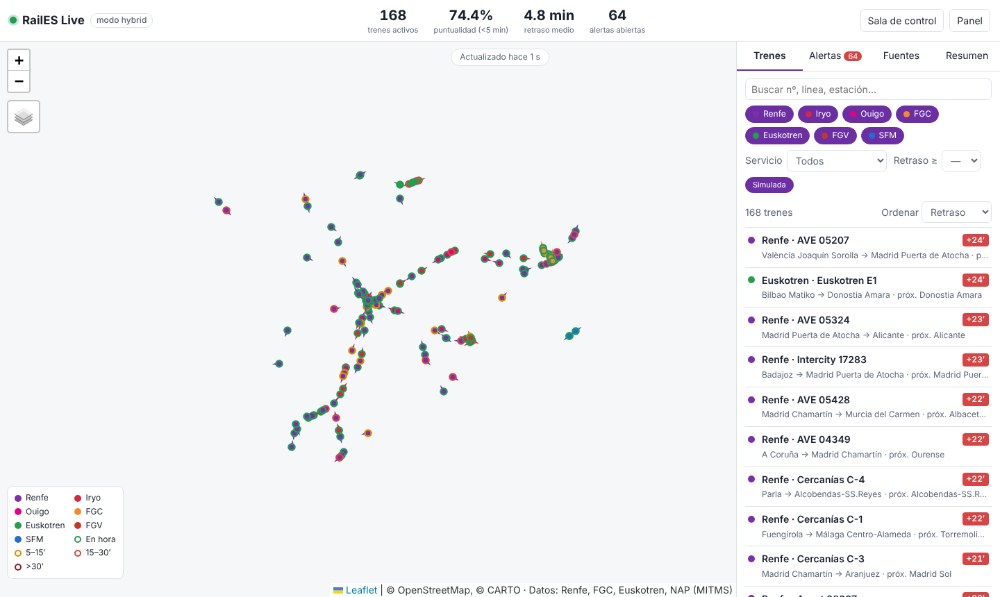

# RailES Live

Visión en tiempo real y gestión visual de los trenes de pasajeros de España: mapa con la posición de cada tren, retrasos, alertas, KPIs de puntualidad y estado de las fuentes de datos. Generado a partir de [`docs/PROMPT_trenes_espana.md`](docs/PROMPT_trenes_espana.md).



## Arranque

```bash
npm install
npm start              # http://localhost:3000 (modo hybrid)
MODE=simulation npm start   # solo simulador (demo/desarrollo)
MODE=live npm start         # solo fuentes reales
npm test
```

Con Docker: `docker compose up --build`.

## Fuentes de datos

| Adaptador | Operador | Tipo de posición | Estado |
|---|---|---|---|
| `renfe-cercanias` | Renfe Cercanías / Rodalies | GPS (GTFS-RT JSON) | Activo por defecto |
| `renfe-ld` | Renfe AVE / Alvia / Avant / MD / Regional | Operador (visor `flotaLD.json`) | Activo por defecto |
| `fgc` | FGC | GPS (Opendatasoft) | Activo por defecto |
| `euskotren` / cualquier `type: "gtfs-rt"` | Euskotren, FGV… | GPS (GTFS-RT protobuf) | Requiere URL en `config.json` / `EUSKOTREN_RT_URL` |
| `schedule` | Iryo, Ouigo, FGV, SFM, Feve… | Horario (GTFS estático interpolado sobre `shapes`) | Requiere feeds en `config.json` |
| `simulator` | Todos (≈170 trenes sobre corredores reales) | Simulada | Modos `simulation` e `hybrid` |

Copia `config.example.json` a `config.json` y rellena las URLs vigentes del [Punto de Acceso Nacional](https://nap.transportes.gob.es) (descarga de GTFS de Iryo, Ouigo, etc.).
Para traducir códigos de estación de Renfe a nombres, coloca el CSV de estaciones de data.renfe.com en `data/estaciones.csv`.

**Las URLs y formatos de las fuentes públicas cambian sin aviso**. Los parsers son tolerantes, pero valida cada fuente al desplegar (pestaña *Fuentes*). Respeta las licencias y términos de uso de cada operador; el sondeo por defecto es de 20–30 s con backoff exponencial.
Si estás detrás de un proxy corporativo, arranca Node con `NODE_USE_ENV_PROXY=1` para que `fetch` use `HTTPS_PROXY`.

## API

`GET /api/trains?operator=&service=&minDelay=&bbox=w,s,e,n&q=` · `GET /api/trains/:id` (incluye estela) · `GET /api/stats` · `GET /api/sources` · `GET /api/alerts` · `POST /api/alerts/:id/ack` · `GET /api/stations` · `GET /api/stream` (SSE: `snapshot`, `alerts`, `alert`) · `GET /api/health`

## Estructura

```
src/server.js            Fastify: API REST + SSE + estáticos
src/sources.js           planificador de adaptadores (intervalo, backoff, estado)
src/core/registry.js     trenes normalizados, deduplicación por calidad, estela, rumbo/velocidad, expiración
src/core/alerts.js       alertas de retraso (5/15/30 min), tren detenido, fuente caída/recuperada
src/adapters/*           un adaptador por fuente + motor GTFS de horario + simulador
public/                  SPA Leaflet (canvas): mapa, filtros, lista, ficha, alertas, fuentes, resumen, sala de control
```

## Pendiente (v2)
Persistencia histórica (PostgreSQL+PostGIS / TimescaleDB) y reproducción temporal, tablero de puntualidad por corredor, mercancías (sin datos públicos), inset de Canarias y WebGL (MapLibre) para más de 5 000 trenes.
