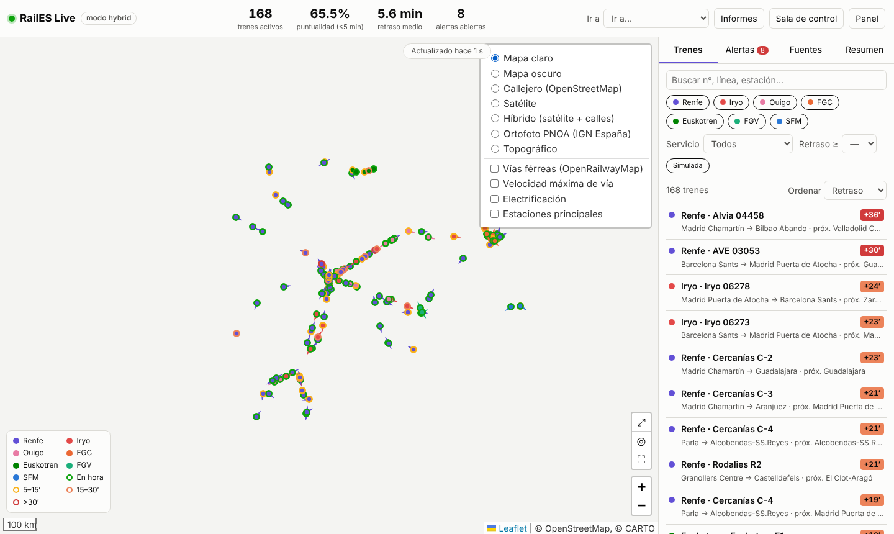
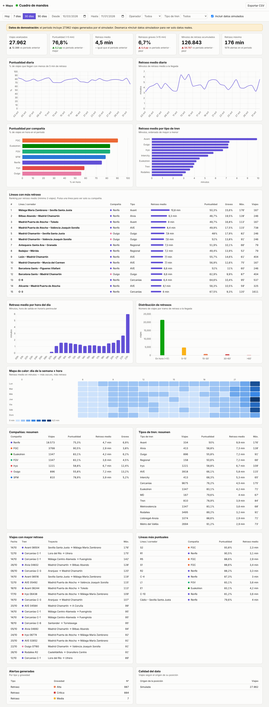
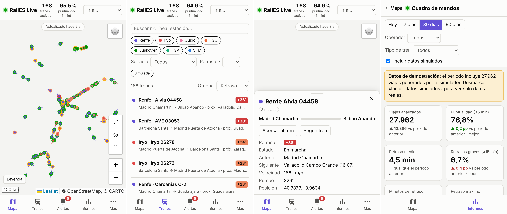

# RailES Live

Visión en tiempo real y gestión visual de los trenes de pasajeros de España: mapa con la posición de cada tren, retrasos, alertas, KPIs de puntualidad y estado de las fuentes de datos. Generado a partir de [`docs/PROMPT_trenes_espana.md`](docs/PROMPT_trenes_espana.md).



## Novedades v0.2

- **Capas de mapa:** OpenStreetMap (por defecto, sin clave), mapa oscuro, **satélite**, **híbrido** (satélite + calles y topónimos), **ortofoto PNOA del IGN** topográfico y, opcionalmente, CARTO (puede pedir clave de API). Capas superpuestas: vías férreas, velocidad máxima de vía, electrificación (OpenRailwayMap) y estaciones. La elección se recuerda entre visitas.
- **Zoom:** rueda/trackpad suave, pellizco en móvil, doble clic sobre un tren para acercarse, *Mayús + arrastrar* para ampliar una zona, selector «Ir a» (Madrid, Barcelona, València…), botones de ver toda España, **mi ubicación** y pantalla completa, botón «Acercar al tren» y **«Seguir tren»**. A zoom alto los trenes muestran su número y retraso.
- **Cuadro de mandos de informes** (`/informes.html`): ver abajo.
- **App móvil:** diseño móvil con navegación inferior y PWA instalable; envoltorio nativo Android/iOS en [`mobile/`](mobile/README.md).

## Cuadro de mandos de informes



El servidor guarda una muestra por minuto de cada tren en SQLite (`data/history.db`) y la explota en `/informes.html`:

- **KPI** con variación frente al periodo anterior: viajes, puntualidad (<5 min), retraso medio, % de retrasos graves (≥15 min), minutos de retraso acumulados, retraso máximo y alertas.
- Evolución diaria de puntualidad y retraso medio.
- Puntualidad **por compañía** y retraso **por tipo de tren**.
- **Ranking de líneas/corredores con más retraso** y de las más puntuales.
- Retraso por **hora del día** y **mapa de calor día de la semana × hora**.
- Distribución de retrasos, viajes con mayor retraso, alertas por tipo y gravedad, y calidad del dato.
- Filtros por periodo, compañía y tipo de tren (en la URL, para compartir un informe) y **exportación CSV** de cada tabla.

Mientras no haya historia real, en los modos `simulation`/`hybrid` se generan 45 días de **datos de demostración** marcados como simulados. El informe lo avisa, y se pueden excluir con la casilla «Incluir datos simulados». Para empezar de cero, borra `data/history.db`.

## App móvil



- **PWA:** desde el móvil abre la web (en HTTPS) → *Instalar aplicación* (Android) o *Añadir a pantalla de inicio* (iPhone).
- **Nativa (Google Play / App Store):** proyecto Capacitor en [`mobile/`](mobile/README.md).

## Arranque

```bash
npm install
npm start              # http://localhost:3000 (modo hybrid)
MODE=simulation npm start   # solo simulador (demo/desarrollo)
MODE=live npm start         # solo fuentes reales
npm test
```

Requiere Node.js 20 o superior; los informes necesitan Node.js 22.13 o superior (usan el SQLite integrado `node:sqlite`). Con un Node anterior, el mapa funciona y los informes avisan de que hay que actualizar.

Con Docker: `docker compose up --build`.

## Fuentes de datos

| Adaptador | Operador | Tipo de posición | Estado |
|---|---|---|---|
| `renfe-cercanias` | Renfe Cercanías / Rodalies | GPS (GTFS-RT JSON) | Activo por defecto |
| `renfe-ld` | Renfe AVE / Alvia / Avant / MD / Regional | Operador (visor `flotaLD.json`) | Activo por defecto |
| `fgc` | FGC | GPS (Opendatasoft) | Activo por defecto |
| `euskotren` / cualquier `type: "gtfs-rt"` | Euskotren, FGV… | GPS (GTFS-RT protobuf) | Requiere URL en `config.json` / `EUSKOTREN_RT_URL` |
| `schedule` | Iryo, Ouigo, FGV, SFM, Feve… | Horario (GTFS estático interpolado sobre `shapes`) | Requiere feeds en `config.json` |
| `simulator` | Todos (≈170 trenes sobre corredores reales) | Simulada | Modos `simulation` e `hybrid` |

Copia `config.example.json` a `config.json` y rellena las URLs vigentes del [Punto de Acceso Nacional](https://nap.transportes.gob.es) (descarga de GTFS de Iryo, Ouigo, etc.).
Para traducir códigos de estación de Renfe a nombres, coloca el CSV de estaciones de data.renfe.com en `data/estaciones.csv`.

**Las URLs y formatos de las fuentes públicas cambian sin aviso**. Los parsers son tolerantes, pero valida cada fuente al desplegar (pestaña *Fuentes*). Respeta las licencias y términos de uso de cada operador; el sondeo por defecto es de 20–30 s con backoff exponencial.
Si estás detrás de un proxy corporativo, arranca Node con `NODE_USE_ENV_PROXY=1` para que `fetch` use `HTTPS_PROXY`.

## API

`GET /api/trains?operator=&service=&minDelay=&bbox=w,s,e,n&q=` · `GET /api/trains/:id` (incluye estela) · `GET /api/stats` · `GET /api/sources` · `GET /api/alerts` · `POST /api/alerts/:id/ack` · `GET /api/stations` · `GET /api/reports?from=&to=&operator=&service=&includeSimulated=0` · `GET /api/reports/export/{lineas|operadores|servicios|diario|horas|viajes}` · `GET /api/stream` (SSE: `snapshot`, `alerts`, `alert`) · `GET /api/health`

## Estructura

```
src/server.js            Fastify: API REST + SSE + estáticos
src/sources.js           planificador de adaptadores (intervalo, backoff, estado)
src/core/registry.js     trenes normalizados, deduplicación por calidad, estela, rumbo/velocidad, expiración
src/core/alerts.js       alertas de retraso (5/15/30 min), tren detenido, fuente caída/recuperada
src/core/history.js      histórico SQLite (viajes, agregados horarios, alertas)
src/core/reports.js      consultas del cuadro de mandos y exportación CSV
src/adapters/*           un adaptador por fuente + motor GTFS de horario + simulador
public/                  SPA Leaflet (canvas) + informes (Chart.js) + PWA (manifest, service worker, iconos)
mobile/                  envoltorio nativo Capacitor (Android/iOS)
```

## Pendiente (v2)
Reproducción temporal de posiciones, migración del histórico a PostgreSQL/TimescaleDB si crece mucho, notificaciones push de alertas en la app, mercancías (sin datos públicos), inset de Canarias y WebGL (MapLibre) para más de 5 000 trenes.
